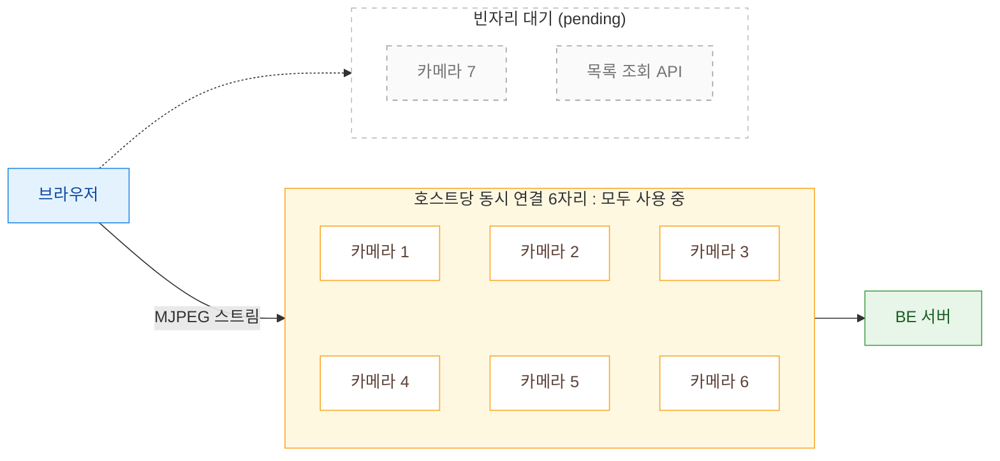
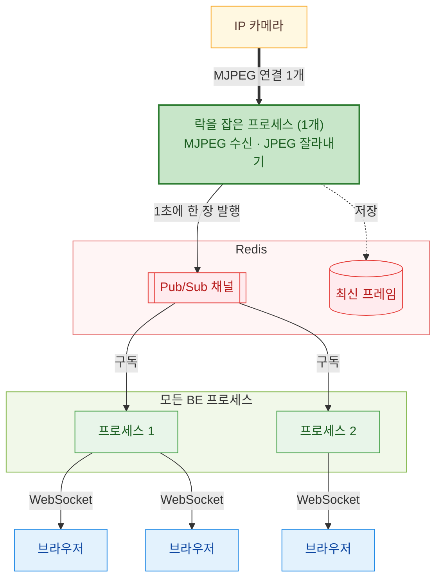
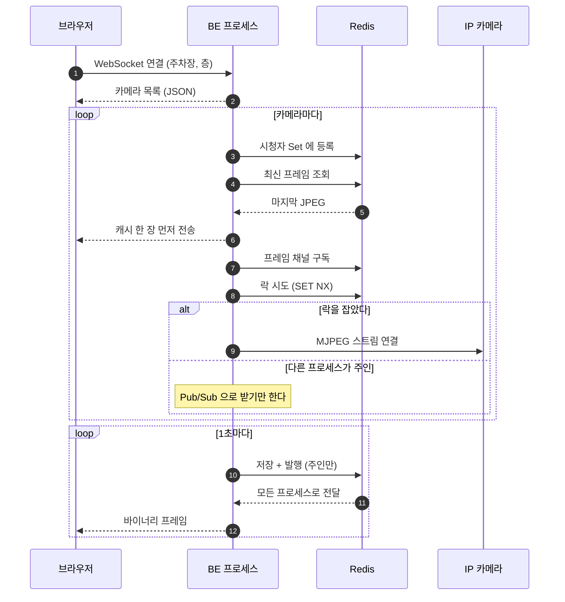
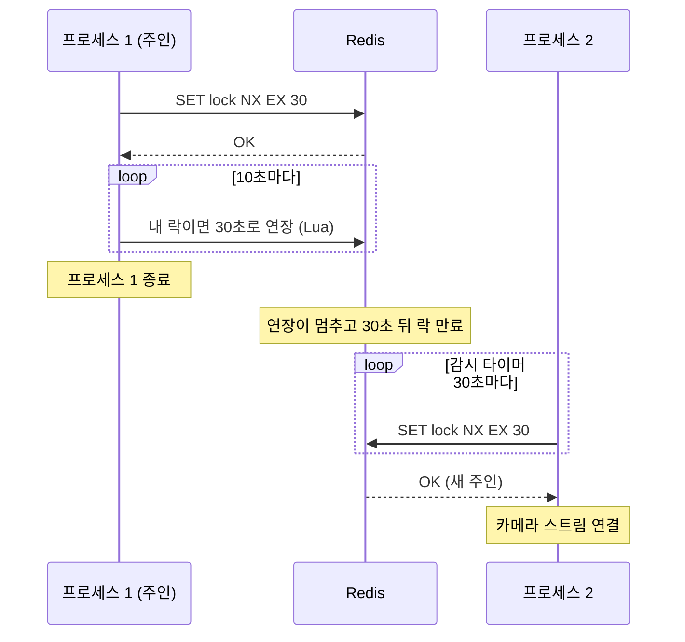
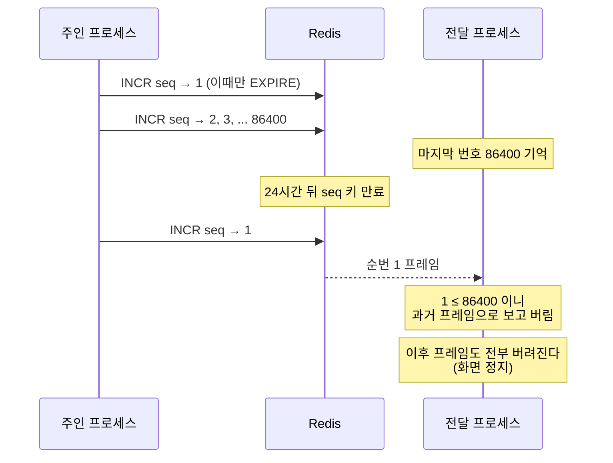
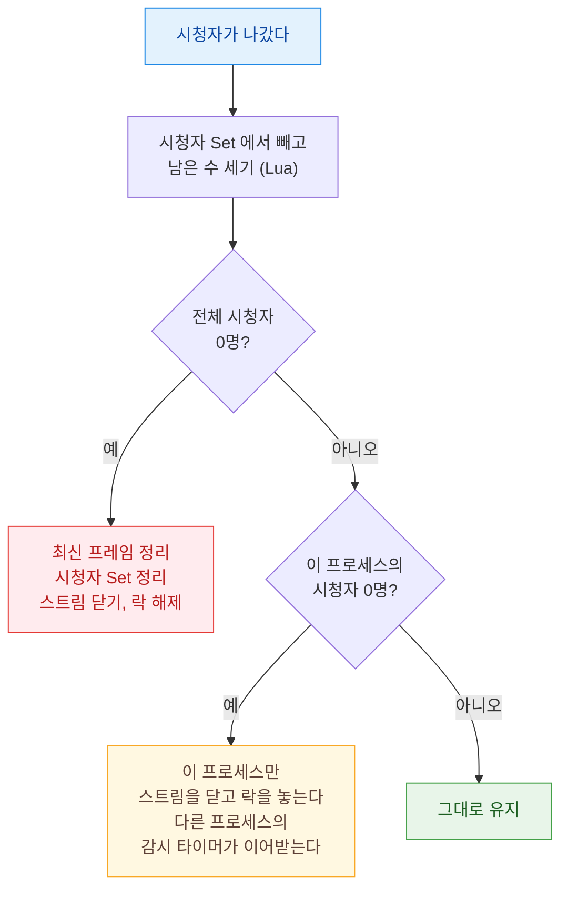
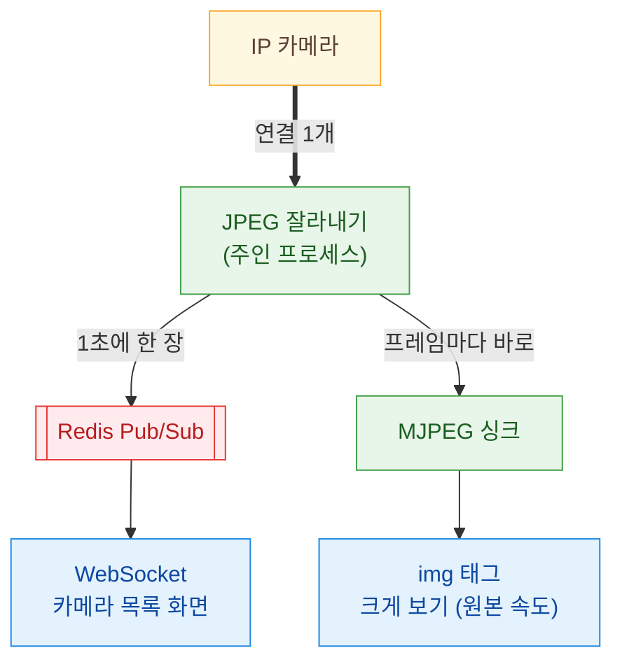

- 참고사이트
  - [MDN EventSource](https://developer.mozilla.org/en-US/docs/Web/API/EventSource){:target="_blank"}
  - [Redis SET](https://redis.io/docs/latest/commands/set/){:target="_blank"}
  - [Chromium client_socket_pool_manager.cc](https://source.chromium.org/chromium/chromium/src/+/main:net/socket/client_socket_pool_manager.cc){:target="_blank"}


### 시작하기 전에

현재 작업중인 주차 관제 시스템은 관제 화면에서 주차장 한 층에 설치된 카메라 수십 대의 영상을 한번에 보여줘야 한다. <br/>
카메라 영상은 IP 카메라가 내보내는 MJPEG 스트림을 BE 가 받아서 브라우저로 전달하는 구조다. <br/>
<br/>
그런데 카메라마다 MJPEG 스트림을 하나씩 열다 보니, 브라우저에서 동시에 볼 수 있는 스트림이 `6개` 를 넘지 못했다. <br/>
원인은 브라우저의 동시 연결 제한이었고, 브라우저 연결은 WebSocket 하나로 묶고 `BE 와 IP 카메라 사이의 스트림은 Redis 를 이용해 공유`하는 방식으로 해결했다. <br/>
<br/>
이 글은 해당 내용에 대해 해결하는 과정을 기록하는 포스팅이다.

<br/>
<hr/>

### MJPEG 스트림이란?

MJPEG(Motion JPEG) 은 JPEG 사진을 연속으로 보내서 영상처럼 보이게 하는 방식이다. <br/>
HTTP 로 보낼 때는 `multipart/x-mixed-replace` 응답 하나에 JPEG 를 끝없이 이어 붙인다.

```
HTTP/1.1 200 OK
Content-Type: multipart/x-mixed-replace; boundary=frame

--frame
Content-Type: image/jpeg

<JPEG 1>
--frame
Content-Type: image/jpeg

<JPEG 2>
...                       ← 응답이 끝나지 않는다
```

사용법은 심플하다. 브라우저에서 `` 한 줄이면 별도 플레이어 없이 영상이 재생된다. <br/>
하지만 `응답이 끝나지 않는다` 는 특징 때문에 이번 문제가 생긴다.

<br/>
<hr/>

### 7번째 카메라부터 영상이 나오지 않는다

카메라 카드마다 스트림을 하나씩 열면 6대까지는 영상이 잘 나온다. <br/>
하지만 7번째부터는 화면이 비어 있고, 개발자 도구의 네트워크 탭을 보면 해당 요청들이 응답을 받지 못한 채 `pending` 상태로 남아 있다.



영상만 문제가 아니다. <br/>
같은 서버로 가는 다른 요청(목록 조회 같은 API 호출)도 같은 자리를 나눠 쓰기 때문에, 스트림이 자리를 다 차지하면 화면의 다른 데이터까지 함께 멈춘다. <br/>
관제 화면 탭을 하나 더 열면 더 빨리 막힌다.

<br/>
<hr/>

### 원인 : HTTP/1.1 의 호스트당 동시 연결 6개

브라우저는 HTTP/1.1 에서 `같은 호스트로 동시에 열 수 있는 연결 수` 를 제한한다. <br/>
Chrome 은 6개로 고정되어 있고, 다른 주요 브라우저도 기본값이 6개다. 그리고 이 제한은 탭 단위가 아니라 `브라우저 전체` 에 걸린다. <br/>
<br/>
보통의 요청은 응답을 받으면 연결을 돌려주기 때문에 6개로도 충분하다. <br/>
하지만 MJPEG 응답은 끝나지 않는다. 카메라 스트림 하나가 연결 하나를 계속 쥐고 있는 셈이라, 6개를 열면 그 호스트로 가는 자리가 더 이상 남지 않는 것이다. <br/>
<br/>
이 제한을 피하는 방법은 아래와 같다.

| 방법 | 내용 | 한계 |
| :-- | :-- | :-- |
| HTTP/2 | 연결 하나에서 여러 요청을 동시에 주고받는다(다중화). 6개 제한이 사라진다 | 브라우저는 HTTPS 에서만 HTTP/2 를 쓴다. 서버가 카메라에 붙는 연결 수는 그대로다 |
| 도메인 나누기 | 호스트마다 6개이기 때문에 서브도메인을 여러 개 둔다 | 카메라가 늘어날 때마다 도메인을 늘려야 한다 |
| 스냅샷 폴링 | 몇 초마다 사진을 한 장씩 요청한다. 연결을 오래 잡지 않는다 | 카메라 수 × 주기만큼 요청이 생기고, 화면 갱신이 느리다 |
| WebSocket 하나로 묶기 | 연결 하나로 여러 카메라의 프레임을 보낸다 | 프레임마다 어느 카메라의 것인지 표시해야 한다 |

마지막 방법을 선택했다. <br/>
관제 화면은 층 단위로 카메라를 보여주기 때문에 `층 하나에 WebSocket 하나` 면 충분하다. 카메라가 몇 대든 브라우저 연결은 하나다. <br/>
참고로 Chromium 은 WebSocket 연결을 일반 HTTP 연결과 따로 관리하기 때문에, WebSocket 은 위의 6자리를 차지하지 않는다.

<br/>
<hr/>

### 카메라도 동시 접속 제한이 있다

브라우저 연결을 하나로 묶었다고 끝이 아니다. <br/>
`IP 카메라도 동시에 받을 수 있는 접속 수가 정해져 있다.` <br/>
시청자마다 BE 가 카메라에 새로 붙는 구조라면, 관제 요원 몇 명이 같은 층을 여는 것만으로 카메라 접속이 바닥난다. <br/>
BE 를 여러 프로세스로 늘리면 프로세스마다 같은 카메라에 붙기 때문에 더 빨리 바닥난다. <br/>
<br/>
그래서 목표를 두 가지로 잡았다.

- 브라우저 : 화면(층) 하나에 연결 하나
- 카메라 : 시청자가 몇 명이든, BE 프로세스가 몇 개든 카메라 하나에 연결 하나

브라우저 쪽은 WebSocket 으로, 카메라 쪽은 Redis 로 해결한다. <br/>
BE 와 IP 카메라 사이의 스트림을 `카메라당 하나만 열고`, 그 프레임을 Redis 를 통해 모든 프로세스와 시청자가 나눠 쓰는 구조다. <br/>
지금은 BE 를 프로세스 하나로 운영하고 있지만, 프로세스를 늘려도 그대로 동작하도록 처음부터 Redis 를 중심에 두었다.

<br/>
<hr/>

### 전체 구조



카메라에 붙는 건 락을 잡은 프로세스 하나뿐이고, 프레임은 Redis 를 거쳐 모든 프로세스(주인 포함)에서 자기에게 붙은 시청자에게 전달된다. <br/>
Redis 에는 카메라마다 아래 네 가지를 둔다.

| Redis | 쓰임 | 없으면 |
| :-- | :-- | :-- |
| 락 | 카메라에 연결을 여는 프로세스(주인)를 하나로 정한다 | 프로세스마다 카메라에 붙는다 |
| 시청자 Set | 그 카메라를 보고 있는 시청자 목록. 모든 프로세스의 시청자를 합쳐서 센다 | 아무도 안 보는 카메라를 언제 끊을지 모른다 |
| 최신 프레임 | 마지막 JPEG 한 장 (TTL 30초) | 새 시청자는 다음 프레임이 올 때까지 빈 화면을 본다 |
| Pub/Sub 채널 | 주인 프로세스가 받은 프레임을 모든 프로세스로 뿌린다 | 주인 프로세스에 붙은 시청자만 영상을 본다 |

접속부터 프레임을 받기까지의 흐름은 아래와 같다.



이제 단계별로 고민했던 부분을 정리해보자. 아래 코드는 원리만 남긴 예제 코드다.

<br/>
<hr/>

### 프레임에 카메라 이름표 붙이기

WebSocket 하나로 여러 카메라를 보내려면, 받는 쪽에서 이 JPEG 가 어느 카메라의 것인지 알아야 한다. <br/>
JSON 에 base64 로 넣으면 크기가 1/3 정도 늘어나기 때문에, 바이너리 메시지 앞에 짧은 헤더를 붙였다.

| 크기 | 필드 | 설명 |
| :-- | :-- | :-- |
| 1 byte | keyLen | 카메라 키 길이 |
| N bytes | cameraKey | `{주차장}:{카메라}` (UTF-8, 128바이트 이하) |
| 4 bytes | seq | 프레임 순번 (uint32, big endian) |
| 나머지 | JPEG | 이미지 |

순번이 필요한 이유는 아래에서 다시 설명한다. <br/>
접속 직후에 보내는 캐시 한 장에는 순번이 없고, 받는 쪽은 키 바로 뒤가 JPEG 시작 표시(`FF D8`)인지를 보고 구분한다.

> 서버 : 프레임 앞에 카메라 키와 순번 붙이기

```ts
function packFrame(cameraKey: string, seq: number, jpeg: Buffer): Buffer {
  const key = Buffer.from(cameraKey, 'utf8');
  const header = Buffer.alloc(1 + key.length + 4);
  header.writeUInt8(key.length, 0);
  key.copy(header, 1);
  header.writeUInt32BE(seq, 1 + key.length);
  return Buffer.concat([header, jpeg]);
}
```

> 브라우저 : 바이너리 메시지를 풀어서 카메라 카드에 그리기

화면 쪽 디코딩과 렌더링은 프론트엔드 팀원이 담당했고, 원리는 아래와 같다.

```ts
ws.binaryType = 'arraybuffer';
const lastUrl = new Map<string, string>();

ws.onmessage = (e) => {
  if (typeof e.data === 'string') return onControl(JSON.parse(e.data)); // 카메라 목록 같은 제어 메시지

  const bytes = new Uint8Array(e.data as ArrayBuffer);
  const keyLen = bytes[0];
  const cameraKey = new TextDecoder().decode(bytes.subarray(1, 1 + keyLen));

  let offset = 1 + keyLen;
  const isJpegAt = (i: number) => bytes[i] === 0xff && bytes[i + 1] === 0xd8;
  if (!isJpegAt(offset)) offset += 4; // 순번이 붙은 라이브 프레임
  if (!isJpegAt(offset)) return;      // 형식이 어긋난 메시지는 버린다

  const url = URL.createObjectURL(new Blob([bytes.subarray(offset)], { type: 'image/jpeg' }));
  const prev = lastUrl.get(cameraKey);
  if (prev) URL.revokeObjectURL(prev);
  lastUrl.set(cameraKey, url);
  render(cameraKey, url);
};
```

눈여겨 볼 부분은 `URL.revokeObjectURL` 이다. <br/>
프레임마다 Blob URL 을 새로 만들기 때문에, 이전 URL 을 풀어주지 않으면 메모리가 계속 쌓인다.

<br/>
<hr/>

### 카메라에는 락을 잡은 프로세스 하나만 붙는다

카메라 연결을 하나로 만드는 핵심은 Redis 락이다. <br/>
카메라마다 락 키를 두고, `SET NX`(키가 없을 때만 저장) 로 먼저 잡은 프로세스가 주인이 된다.

- 주인은 10초마다 락을 30초로 다시 연장한다.
- 주인 프로세스가 죽으면 연장이 멈추고, 30초 뒤에 락이 풀린다.
- 모든 프로세스에서 30초마다 도는 감시 타이머가 `시청자는 있는데 스트림이 없는 카메라` 를 찾아서 락을 다시 잡는다.

그래서 주인이 죽어도 길어야 1분 정도면 다른 프로세스가 스트림을 이어받는다.



락을 연장하거나 풀 때는 반드시 `내 락일 때만` 해야 한다. <br/>
`GET` 으로 확인하고 `EXPIRE` 나 `DEL` 을 따로 보내면, 그 사이에 TTL 이 끝나서 다른 프로세스가 새로 잡은 락을 내가 연장하거나 지워버릴 수 있다. <br/>
확인과 실행을 Lua 스크립트 하나로 묶으면 Redis 가 중간에 다른 명령을 끼워 넣지 않는다.

```ts
// 잡기 : 키가 없을 때만(NX) 30초짜리로. 값은 내 프로세스 ID
const acquired = (await redis.set(`lock:${cameraKey}`, processId, 'EX', 30, 'NX')) === 'OK';

// 연장 : 내 락일 때만
const RENEW = `
if redis.call('GET', KEYS[1]) == ARGV[1] then
  return redis.call('EXPIRE', KEYS[1], ARGV[2])
end
return 0`;

// 해제 : 내 락일 때만
const RELEASE = `
if redis.call('GET', KEYS[1]) == ARGV[1] then
  return redis.call('DEL', KEYS[1])
end
return 0`;

await redis.eval(RENEW, 1, `lock:${cameraKey}`, processId, 30);
```

락을 잡지 못한 프로세스는 카메라에 붙지 않고, Pub/Sub 으로 프레임을 받기만 한다.

<br/>
<hr/>

### JPEG 잘라내기, 그리고 1초에 한 장

주인 프로세스는 카메라의 MJPEG 응답을 받아서 JPEG 시작 표시(`FF D8`) 와 끝 표시(`FF D9`) 로 프레임을 잘라낸다. <br/>
그리고 프레임이 올 때마다 바로 보내지 않고 `최신 한 장만 들고 있다가`(새 프레임이 오면 덮어쓴다), 정해진 간격(기본 1초)마다 그 한 장을 발행한다. <br/>
<br/>
관제 화면의 카메라 목록은 영상을 감상하는 용도가 아니라 상태를 확인하는 용도다. <br/>
카메라가 초당 여러 장을 보내더라도 화면에는 1초에 한 장이면 충분하고, 이렇게 해야 카메라 수십 대 × 원본 속도만큼 대역폭이 불어나지 않는다.

```ts
const SOI = Buffer.from([0xff, 0xd8]); // JPEG 시작
const EOI = Buffer.from([0xff, 0xd9]); // JPEG 끝

let acc = Buffer.alloc(0);
let pending: Buffer | null = null;

cameraStream.on('data', (chunk: Buffer) => {
  acc = Buffer.concat([acc, chunk]);
  if (acc.length > MAX_BUFFER_BYTES) {
    acc = Buffer.alloc(0); // 끝 표시가 안 오는 스트림 방어 — 버리고 다음 조각부터 다시
    return;
  }

  let start = acc.indexOf(SOI);
  while (start !== -1) {
    const end = acc.indexOf(EOI, start + 2);
    if (end === -1) break;                  // 아직 덜 왔다
    pending = acc.subarray(start, end + 2); // 최신 한 장만 남긴다
    acc = acc.subarray(end + 2);
    start = acc.indexOf(SOI);
  }
});

setInterval(() => {
  if (!pending) return;
  const jpeg = pending;
  pending = null;
  // 최신 프레임 저장 + 채널 발행. 타이머 안의 실패가 프로세스를 죽이지 않게 잡아둔다
  publishFrame(cameraKey, jpeg).catch((e) => logger.warn('publish failed', e));
}, BROADCAST_INTERVAL_MS);
```

이렇게 하면 카메라가 보내는 속도와 화면에 보내는 속도가 분리된다. 화면에 보내는 간격은 설정값 하나로 바꿀 수 있다.

<br/>
<hr/>

### 새 시청자에게는 캐시 한 장부터

#### 첫 화면

새 시청자가 다음 발행을 기다리면 최대 1초 동안 빈 화면을 보게 된다. <br/>
그래서 Redis 에 저장해둔 최신 프레임 한 장을 먼저 보낸다. 다른 프로세스가 주인이어도 Redis 에 있으니 바로 꺼낼 수 있다. <br/>
<br/>
이때 순서가 중요하다.

```ts
// 순서를 바꾸지 말 것 : 등록 → 캐시 한 장 → 채널 구독
await addViewer(cameraKey, clientId);                     // ① 시청자 Set 등록
const cached = await getLatestFrame(cameraKey);
if (cached) ws.send(packInitialFrame(cameraKey, cached)); // ② 캐시 한 장 (순번 없음)
await subscribeFrames(cameraKey);                         // ③ 이후 프레임은 채널로
```

③ 이 ② 보다 먼저 일어나면, 채널로 새 프레임이 먼저 도착한 뒤에 캐시에서 꺼낸 옛 프레임이 그 위에 그려진다. 화면이 순간적으로 `과거로 되감기는` 것이다. <br/>
그래서 실제 코드에는 이 순서 옆에 `재배열 금지` 주석을 남겨두었다.

#### 프레임 순번

같은 채널에 발행하는 경로가 하나뿐이면 순서가 꼬일 일이 없다. <br/>
하지만 재연결 중에 마지막 프레임을 다시 발행하는 타이머처럼(아래 안전장치 참고) 발행 경로가 둘 이상이 되면, 오래된 프레임이 새 프레임 뒤에 도착할 수 있다. <br/>
<br/>
그래서 주인 프로세스가 프레임마다 Redis `INCR` 로 전역 순번을 받아 헤더에 붙이고, 각 프로세스는 `마지막으로 내보낸 번호 이하의 프레임은 버린다.`

#### 24시간 뒤 멈출 뻔한 순번

그런데 이 순번에 함정이 숨어 있었다. <br/>
코드를 다시 점검하다가, 서비스를 띄우고 `하루가 지나면 카메라 화면이 영원히 멈출 수 있는` 경로를 발견했다. <br/>
<br/>
처음 구현은 `INCR` 결과가 1 일 때만(키가 처음 생길 때만) 24시간짜리 `EXPIRE` 를 걸었다. <br/>
그러면 24시간 뒤에 키가 만료되고, 다음 `INCR` 은 다시 1부터 시작한다. <br/>
각 프로세스는 하루치만큼 커진 마지막 번호를 기억하고 있기 때문에, 1부터 다시 올라오는 프레임을 전부 과거 프레임으로 보고 버린다. <br/>
순서를 지키려고 넣은 장치가 정상 프레임을 모두 막아버리는 것이다. 에러 로그도 남지 않는다.



```lua
-- 매 프레임 번호를 받으면서 만료 시간도 다시 건다 → 스트리밍 중에는 키가 만료되지 않는다
local n = redis.call('INCR', KEYS[1])
redis.call('EXPIRE', KEYS[1], ARGV[1])
return n
```

수정은 두 가지로 했다.

- 원인 제거 : `INCR` 과 `EXPIRE` 를 Lua 로 묶어서 매 프레임마다 TTL 을 다시 건다.
- 안전장치 : 그래도 번호가 리셋되는 경우를 대비해, 받은 번호가 마지막 번호보다 100 넘게 작으면 역순이 아니라 리셋으로 보고 받아들인다. 정상적인 역순은 몇 프레임 이내다.

<br/>
<hr/>

### 아무도 안 보면 카메라 연결 끊기

카메라 연결은 누군가 보고 있을 때만 열려 있어야 한다. <br/>
그런데 시청자는 여러 프로세스에 흩어져 있기 때문에, 한 프로세스의 메모리만 봐서는 `아무도 안 본다` 를 판단할 수 없다. <br/>
그래서 시청자 Set 을 Redis 에 두고 전체 합산으로 판단한다.



여기서도 명령 두 개 사이의 틈이 문제가 된다.

```ts
// 시청자 제거와 남은 수 세기를 한 번에 — 따로 보내면 그 사이 다른 프로세스가 끼어들어 수를 잘못 센다
const REMOVE_AND_COUNT = `
redis.call('SREM', KEYS[1], ARGV[1])
return redis.call('SCARD', KEYS[1])`;

// 등록과 TTL 을 한 번에 — 둘 사이에 프로세스가 강제 종료되면 TTL 없는 Set 이 남는다
const ADD_WITH_TTL = `
redis.call('SADD', KEYS[1], ARGV[1])
return redis.call('EXPIRE', KEYS[1], ARGV[2])`;
```

두 번째가 특히 고약하다. <br/>
TTL 없는 Set 이 남으면 전체 시청자 수가 영원히 0 이 되지 않아서, 아무도 보지 않는 카메라에 연결이 계속 붙어 있게 된다. <br/>
배포 중에 프로세스가 강제 종료되는 순간에만 생기다 보니 재현도 어렵다. <br/>
항상 같이 실행되어야 하는 Redis 명령 두 개는 처음부터 Lua 로 묶는 것이 맞다.

<br/>
<hr/>

### 크게 보기 : 같은 스트림에 올라타기

관제 요원이 카메라 하나를 골라서 크게 볼 때는 1초에 한 장이 아니라 원본 속도의 영상이 필요하다. <br/>
이 경로는 카메라 하나에 MJPEG HTTP 스트림 하나라서 브라우저 6개 제한과는 상관이 없다. <br/>
문제는 카메라 쪽이었다. 기존 프록시는 요청마다 카메라에 새로 붙었기 때문에, 크게 보기를 열 때마다 카메라 접속을 하나씩 더 쓰고 있었다. <br/>
<br/>
그래서 크게 보기 요청도 `이미 열려 있는 스트림에 올라타도록` 변경했다(MJPEG 싱크).



- Pub/Sub 을 거치지 않는다 : 프레임을 잘라내는 곳에 바로 연결한다. Pub/Sub 경로는 1초에 한 장으로 줄인 프레임이라 거기 붙이면 영상도 1초에 한 장이 되고, 원본 속도의 영상을 Redis 로 중계하면 Pub/Sub 이 사실상 영상 전송로가 되어버린다.
- 조건이 맞을 때만 공유한다 : 같은 화질의 스트림을 요청했고, 이 프로세스가 락 주인이고, 공유 스위치가 켜져 있을 때만 올라탄다. 하나라도 어긋나면 기존 직결 프록시로 돌아가기 때문에, 최악이어도 바꾸기 전과 같다.
- 응답 헤더를 먼저 확정한다 : 싱크는 등록 직후부터 프레임을 받지만, 응답 헤더를 보낸 뒤에야 본문을 쓴다. 본문이 먼저 나가면 응답 형식이 틀어지고, 실패했을 때 기존 경로로 돌아갈 수도 없다.

화면 쪽 요청도 프론트엔드 팀원이 같은 화질의 스트림을 쓰도록 맞춰주면서, 크게 보기 요청이 이 공유 경로를 타게 됐다.

#### 소비자가 늘면 살아 있음의 기준도 넓혀야 한다

싱크를 붙이는 과정에서 문제를 하나 발견했다. 크게 보기로만 보고 있는 스트림이 `15초 뒤에 정리` 되어 버리는 것이다. <br/>
시청자가 없는데 남아 있는 스트림을 치우는 정리 타이머가, `이 프로세스에 시청자가 있는가` 를 WebSocket 연결 수로만 세고 있었기 때문이다.

- 생존 판정을 `WebSocket 수 + MJPEG 싱크 수` 로 바꿨다. 감시 타이머, 정리 타이머, 재연결, 종료 처리가 모두 같은 함수로 판정한다.
- 싱크도 WebSocket 시청자와 같은 시청자 Set 에 등록한다. 빠뜨리면 마지막 WebSocket 시청자가 나갈 때 전체 0명으로 판정되어, 크게 보던 화면의 스트림이 끊긴다.

<br/>
<hr/>

### 그 밖의 안전장치

| 상황 | 처리 |
| :-- | :-- |
| 연결이 너무 많음 | 프로세스당 WebSocket 200개까지. 넘으면 WebSocket 으로 전환하기 전에 HTTP 503 으로 거절한다. 전환을 마친 뒤에 끊으면 이미 자원을 쓴 뒤다 |
| 느린 시청자 | 송신 대기열이 임계치(512KB)를 넘은 시청자에게는 그 프레임을 건너뛴다. 한 명 때문에 다른 시청자가 밀리지 않게 |
| 끝 표시가 안 오는 스트림 | JPEG 를 자르기 전의 누적 버퍼에 상한(5MB)을 둔다 |
| 연결은 살았는데 프레임이 안 옴 | 10초 동안 프레임이 없으면 재연결한다. 카메라 스트림은 생각보다 자주, 조용히 멈춘다 |
| 오래 붙어 있는 연결 | 정상이어도 5분(+최대 30초 무작위)마다 재연결한다. 무작위 시간을 더해서 카메라들이 한꺼번에 재연결하지 않게 한다 |
| 재연결 중 | 마지막 프레임을 계속 다시 발행해서 화면이 멈춘 것처럼 보이지 않게 한다 |
| 재연결 실패 | 3 → 5 → 10 → 30초 간격으로 다시 시도한다 |

<br/>
<hr/>

### 정리

| 문제 | 해결 |
| :-- | :-- |
| 브라우저는 HTTP/1.1 에서 호스트당 연결 6개, MJPEG 은 연결을 놓지 않는다 | 층 하나에 WebSocket 하나. 프레임 앞에 카메라 키를 붙여서 여러 카메라를 한 연결로 보낸다 |
| 카메라 동시 접속 제한 | Redis 락으로 카메라당 연결 하나. 프레임은 Pub/Sub 으로 모든 프로세스에 나눈다 |
| 새 시청자의 빈 화면 | Redis 에 저장한 최신 프레임 한 장부터 보낸다 |
| 프레임 순서 꼬임 | 등록 → 캐시 → 구독 순서를 고정하고, Redis `INCR` 순번으로 옛 프레임을 버린다 |
| 아무도 안 보는 카메라 | 시청자 Set 을 전체 합산해서 0명이면 연결을 끊는다. 명령 두 개는 Lua 로 묶는다 |
| 크게 보기(원본 속도) | 같은 카메라 스트림에 바로 올라탄다. 조건이 안 맞으면 기존 경로로 돌아간다 |

결과적으로 카메라가 늘어나도 브라우저 연결은 `화면당 하나`, 카메라 연결은 `카메라당 하나` 로 고정된다. <br/>
브라우저의 6개 제한 때문에 화면 설계를 타협할 일도 없어졌다. <br/>
<br/>
정리하자면 두 가지 제한을 각각 다른 곳에서 해결한 것이 핵심이다. `브라우저 연결은 화면 단위로 묶고, 카메라 연결은 Redis 로 나눠 쓴다.`
